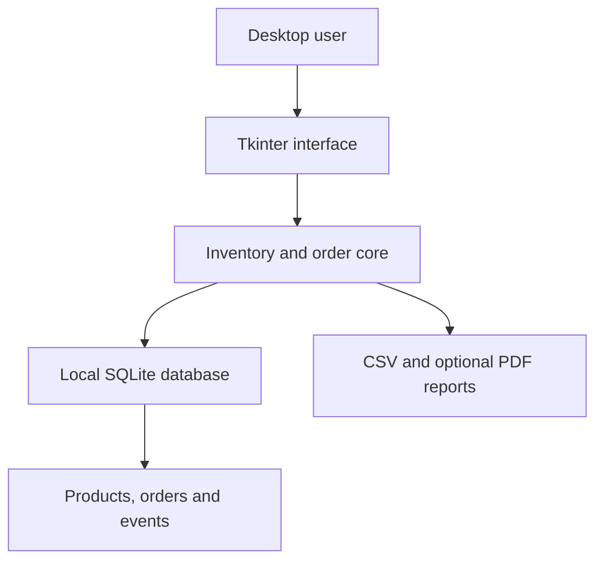

# Application architecture

This document describes the **10 November 2026 maintenance implementation**. It does not retrospectively describe the original coursework as a production system.

The [14 November verification](verification/2026-11-14.md) records subsequent fixes to CSV import and identifier validation. The [assessment map](ASSESSMENT_AND_PROJECT.md) distinguishes this maintained local model from the original coursework's multi-product orders, five-unit stock cap and timed simulation.

## Responsibilities

| Component | Responsibility | Boundary |
|---|---|---|
| `advancepython3.py` | Supported launcher | Delegates to the maintained interface module |
| `warehouse_gui.py` | Read user input, display results and present recoverable errors | Requires Tkinter; window actions need a graphical display |
| `warehouse_core.py` | Validate business input, maintain order/stock invariants and persist changes | Testable without a GUI; no network service |
| SQLite | Store products, orders and timestamped events | Local state; file permissions and backup belong to the operator |
| Reports | Export current application data | Exported files are snapshots, not a second writable source of truth |

## Order and stock rules

An order starts as `registered`, can advance to `queued`, then to `collected`. Cancellation is available before collection and ends at `cancelled`. `collected` and `cancelled` are terminal states.

- Creating an order validates the product and quantity before deducting stock.
- Cancellation restores the reserved quantity once; repeating cancellation returns the cancelled order without additional stock or events.
- Collection finalizes the existing stock deduction and does not restore stock.
- A rejected operation leaves inventory, orders and events unchanged.
- Each accepted state change and its event are committed together.
- Reopening the application reads the saved database; window initialization must not reset stored inventory.

These invariants are local application rules, not evidence of high-availability or distributed transaction guarantees. Read the test suite and verification report for the cases actually exercised.

## Data and failure boundaries

The database is created beneath the selected data directory, not beside the source. `--data-dir` takes precedence over the environment/default location. Missing optional media cannot prevent startup because the maintained interface uses native text and widgets. ReportLab is imported only for PDF output; inventory/order operations remain usable without it.

Validation failures should produce a concise user-facing message. A path that cannot contain the database is a startup/storage failure and must not be treated as a successful save. Database corruption should be investigated from a copy with the application closed; automatic deletion or silent recreation would hide evidence and may lose data.

The supported application does not silently migrate historical files. Its explicit legacy product importer accepts comma/semicolon CSV, validates the complete file, requires an empty inventory and leaves the source unchanged. Imported products receive new database IDs. Historical order/text logs are not migrated.

